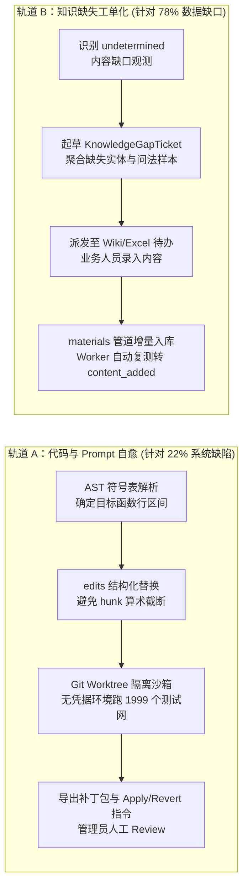

# RAGv3 混合知识体系与自演进闭环架构设计白皮书

> **文档版本**：v1.0 (Rigorous RFC Edition)  
> **状态**：Approved Architecture Proposal  
> **适用范围**：面向团队与企业的 RAG 检索中枢、知识资产治理与自动化运维系统

---

## 1. 架构总览与设计目标

本系统旨在解决企业级知识问答系统中的三大核心工程痛点：
1. **知识表达失真**：单一长文档切块（Naive Chunking）对二维参数表和复杂因果长文本的处理极易发生语义断裂。
2. **知识维护滞后**：传统静态文件库（PDF/Word）缺乏低成本的协同演进与增量同步机制。
3. **系统维护成本高昂**：线上问答链路的坏例（Bad Cases）依赖人工排查，排障周期长且代码修复极易引发未知的业务回归。

系统通过构建**“双模态知识底座（Dual-Modality Knowledge Substrate）”**与**“双轨演进状态机（Dual-Track Evolution State Machine）”**，实现高可靠、强隔离的知识治理与代码自愈。

```mermaid
flowchart TD
    subgraph Layer1["一、 知识资产治理层 (Data Tier)"]
        D1["二维关系数据 (Spreadsheet Service)\n行/列定位 · 细粒度单元格审计 · 确定性参数"]
        D2["网状超文本数据 (Wiki / Markdown)\n原子化词条 · 语法树解析 · 双向链接关联"]
    end

    subgraph Layer2["二、 编译与检索中枢 (Retrieval Engine)"]
        R1["解析分块管道 (AST & Structure-Aware Chunking)"]
        R2["混合检索索引 (Qdrant Dense + SQLite BM25 Sparse)"]
        R3["Jev 策略路由与重排 (Intent Route & RRF Fusion)"]
        R4["证据包约束生成 (Evidence-Constrained Generation)"]
    end

    subgraph Layer3["三、 观测与演进中枢 (Evolution System)"]
        E1["全链路遥测记录器 (ExecutionTracker & FailureRecorder)"]
        E2["频次与特征聚类 (Clusterer: 3-Strike Admission)"]
        E3["两阶段闭环分流 (Decoupled Remediation Engine)"]
    end

    subgraph Layer4["四、 修复与门禁验证 (Validation & Release)"]
        V1["代码/Prompt 修复轨: AST 靶向 -> edits 生成 -> Worktree 沙箱回归"]
        V2["知识缺失治理轨: 实体缺口提取 -> 采编工单 (Gap Ticket) -> 入库复测"]
        ADMIN["管理员终审 (Human-in-the-Loop Release)"]
    end

    Layer1 --> Layer2
    Layer2 --> E1
    E1 --> E2 --> E3
    E3 -->|逻辑/代码缺陷| V1
    E3 -->|数据缺失 (78%)| V2
    V1 --> ADMIN
    V2 --> ADMIN
```

---

## 2. 双模态知识底座建模 (Dual-Modality Knowledge Substrate)

系统在数据接入层将企业知识严格区分为两类正交的数学结构，分别设计专有存储、编辑与切块策略：

### 2.1 结构化二维矩阵 (Tabular Matrix)
* **适用对象**：型号表、价格目录、技术参数、组织权限等离散确定性数据。
* **存储与控制**：基于 `rag/spreadsheets/` 实现。行与列具有强类型约束，通过 `edit_service.py` 捕获原子化单元格变更，在 `SpreadsheetChangesView` 维护完整的变更审计日志（Audit Log）。
* **检索表示**：
  - **确定性查询**：走 `structured_query` 逻辑，直接下推过滤条件；
  - **语义检索**：通过行转文本（Row-to-Text serialization）生成包含列头语义的独立 Chunk，注入向量库与倒排索引。

### 2.2 网状超文本 (Hypertext Wiki)
* **适用对象**：操作规程（SOP）、故障排查指南、制度政策等长篇逻辑叙述。
* **存储与控制**：采用原子化 Markdown 词条，支持版本快照（Revision History）与双向引用解析。
* **检索表示**：
  - 基于语法树（Markdown AST）进行结构感知切块，禁止跨越章节标题和表格结构硬截断；
  - 自动将页面元数据（页面标题、父级分类路径、关联实体标签）作为前缀隐式挂载在 Chunk 文本中，确保切块脱敏后依然保留全局上下文。

---

## 3. 混合检索与证据约束管线 (Retrieval Pipeline)

问答管线采用分层漏斗架构，强制执行“无证据不回答（No Evidence, No Answer）”原则：

1. **查询预处理与意图路由**：
   - 敏感词与注入攻击校验（`check_injection`）；
   - Jev 前置判定（Preflight）：根据置信度与意图，将请求分流至 `structured`、`tool`、`rag` 或 `clarification`。
2. **双路召回与融合（Hybrid Search & Fusion）**：
   - **稠密向量**：硅基流动/百炼 `bge-m3`（1024 维），基于 Qdrant 进行版本与权限过滤查询；
   - **稀疏词法**：基于 SQLite 持久化的 BM25 倒排索引，处理专有名词与精确代号匹配；
   - **RRF 融合**：采用倒数排名融合算法（Reciprocal Rank Fusion），按公式 $RRF\_score = \sum \frac{1}{60 + rank + 1}$ 加权合并候选。
3. **证据包组装与可回答性门禁**：
   - 百炼 `gte-rerank-v2` 语义重排，提取 Top-K 结果；
   - 运行可靠性评估器（`decide_answerability` 与 `assess_confidence`）：当候选块证据不足或出现冲突时，触发安全拒答（`insufficient_evidence`），拒绝调用生成模型，从根源阻断幻觉。

---

## 4. 自演进闭环与沙箱验证机制 (Self-Evolution Architecture)

自演进系统的核心职责是实现线上故障的自动捕获、归因、隔离修复与准出验证。系统将故障严格划分为“系统缺陷”与“知识缺失”双轨并行治理。

### 4.1 故障观测与三振准入 (Observation & Clustering)
* **遥测捕获**：当线上发生执行崩溃（`route=error`）或可回答性拒答（`insufficient_evidence`）时，异步生成非阻塞的 `FailureObservation`，记录脱敏问题、执行轨迹、命中哈希、未捕获异常调用栈（`exception_frame`）及判定统计量。
* **频次准入**：Clusterer 按 `sha256(kb_id | failure_stage | root_cause_feature)` 计算聚类键。必须在 30 天滑动窗口内累计达到 3 次相同特征触发，方可脱离观察队列进入候选池，防止单次网络抖动或偶发噪音引发过度拟合。

### 4.2 结构化诊断 (Deterministic-First Diagnosis)
* **确定性核验优先**：优先利用管理员标签（`admin_labels`）进行型号字符串的精确包含（`label_evidence`）与缺失检查（`label_evidence_absent`），直接锁定排序错误或召回缺失；
* **模型草案约束**：调用推理模型生成 12 字段严格受控的 `DiagnosisDraft`。后置硬规则强制校验：无标签必须标明“假设”，不可复现必须标明“待复核”，违约一律丢弃。

### 4.3 修复实施双轨机制 (Decoupled Remediation)



#### 轨道 A：系统与代码修复 (System Code Track)
1. **靶向定位**：`SymbolIndex` 通过 AST 解析仓库内类与函数的行区间，将中文诊断映射为真实存在的函数符号，生成上下文聚焦的靶心窗口；
2. **结构化编辑（`edits`）**：模型仅输出包含 `path`、`old_text`、`new_text` 的结构化替换块，由内部 `difflib` 装配 Unified Diff，彻底杜绝语法格式破坏与行号算术错误（过界率 100%）；
3. **Worktree 沙箱测试**：在宿主干净分支下拉起临时 `git worktree`，彻底剥离生产环境变量与 API Key，编译补丁并全量执行 24 个离线回归测试网与目标单元测试；
4. **宿主 A/B 门禁**：管理员在宿主环境通过 `measure_patch_regression_ab.py` 跑 20 例端到端基准集，严格遵循门禁阈值：$\Delta \text{Route} \le 0.0\,\text{pp}$，$\Delta \text{Top5} \le 2.0\,\text{pp}$。

#### 轨道 B：知识缺失治理 (Knowledge Gap Track)
1. **工单自动化生成**：针对诊断结论为 `undetermined` 的内容缺口，自动提取高频词与召回缺失词，起草 `KnowledgeGapTicket`，包含出现频次、问法变体与缺失实体清单；
2. **人机协作填补**：工单直接与 Wiki / Excel 录入界面挂钩，业务人员补充对应条款后发布；
3. **入库自动复测**：后台 Worker 定期对 open 状态的工单进行确定性重检索探测。当原缺失词全部被召回覆盖后，工单自动扭转为 `content_added`，实现数据闭环。

---

## 5. 系统安全边界与工程红线 (System Invariants)

为确保系统在自演进过程中不发生不可逆的逻辑崩溃与数据破坏，全局确立以下强制性工程约束：

1. **写操作权能隔离**：系统永远不具备自动执行 `git commit`、`git push` 或线上环境直接热补丁的权限。任何代码变更必须经由管理员在终端显式执行 `git apply`。
2. **不可篡改保护区（Immutable Core）**：
   - 补丁生成器黑名单绝对禁止修改：`rag/evolution/**`（禁止修改免疫本身）、`tests/**`（禁止修改验证网）、`rag/auth.py`、`rag/permissions.py`、`config.py`。
3. **沙箱真空假说**：沙箱内部严格运行在无凭据、无外部网络的环境中，任何需要真实 API Key 的端到端 A/B 验证必须外置到宿主脚本中串行执行，避免无凭据空转伪装成“测试通过”。
4. **数据驱动真实性**：绝对禁止通过在代码主干添加针对特定问题的硬编码 `if-else` 特判来修复知识缺口。没有知识即判定为工单，而非代码补丁。

---

## 6. 技术演进规划与演化指标 (Evaluation Metrics)

| 指标维度 | 当前基准值 | 演进目标值 | 考核机制 |
| :--- | :--- | :--- | :--- |
| **自动化单测覆盖** | 1,999 Passed | $\ge 2,200$ Passed | CI/CD 强卡点，覆盖率零下降 |
| **代码补丁边界通过率** | `edits` 格式 100% (12/12) | 保持 100% | `git apply --check` 必须零报错 |
| **知识缺口转化闭环率** | 工单生成已跑通 (4 张) | 补录后复测达成率 $\ge 90\%$ | Worker 5b 步骤状态扭转监控 |
| **回归门禁路由指标** | $\Delta \text{Route} \le 0.0\,\text{pp}$ | $\Delta \text{Route} \le 0.0\,\text{pp}$ | 20 例 / 100 例基准集宿主 A/B |
| **多轮问答指代消解率** | 0% (缺失上下文改写) | $\ge 85\%$ | 多轮代词追问定向评测套件 |
