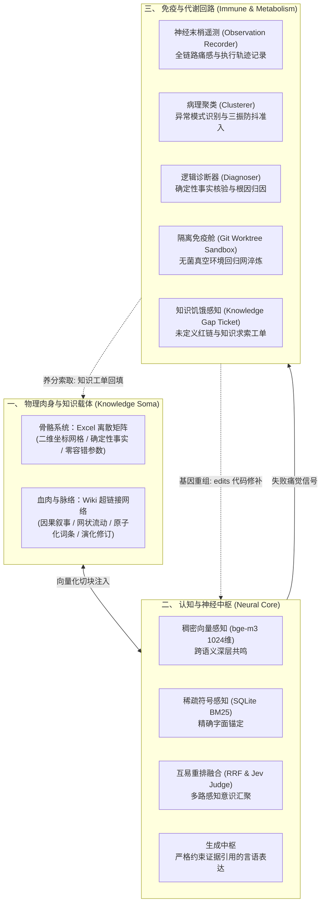
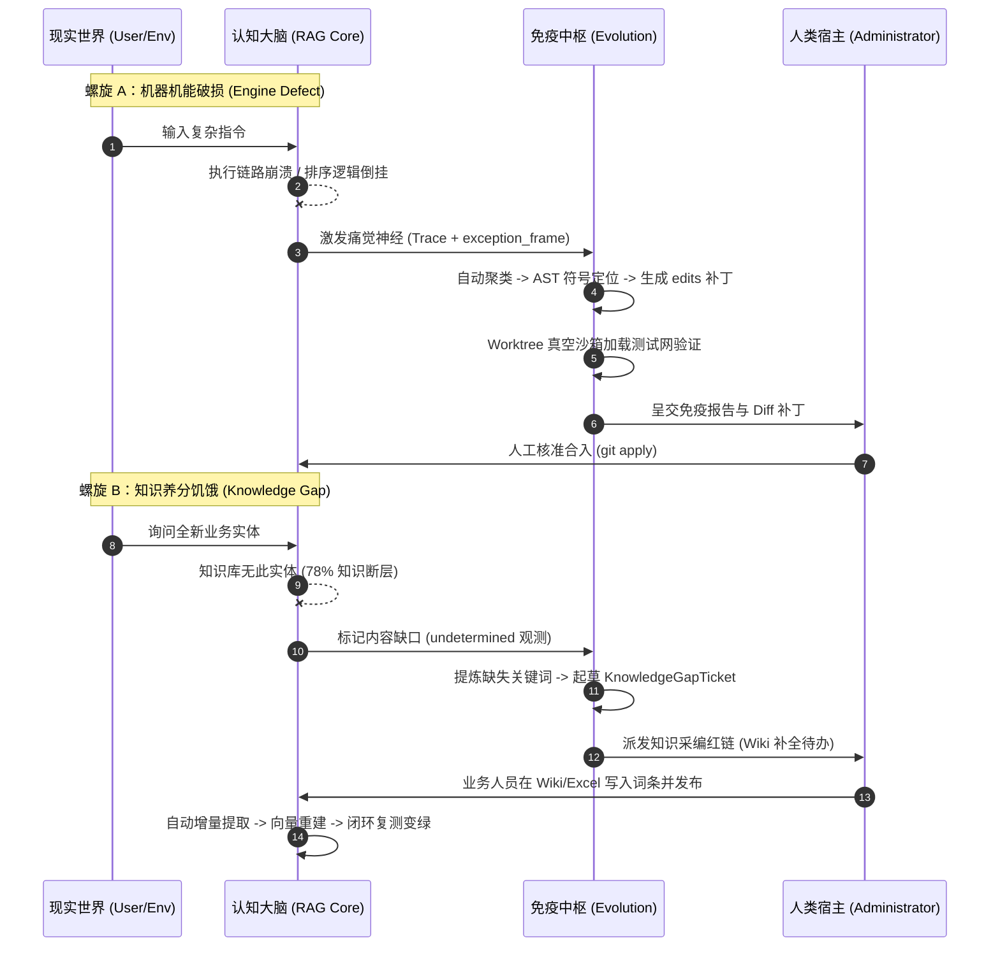

# 双螺旋控制论假说：面向硅基知识有机体的自进化系统宣言

> **代号**：Project Prometheus & Mnemosyne  
> **本体映射**：[RAGv3](file:///d:/Desktop/RAGv3)  
> **公理**：软件不应在熵增中死于技术债，知识不应在断裂中沉入遗忘。系统应当具备自主代谢与免疫能力。

---

## 序言：从“死机器”到“活机体”

传统软件工程受制于**热力学第二定律**：系统自交付之日起便开始不可逆地走向混乱、腐化与熵增。  
传统企业知识库受制于**遗忘曲线与孤岛效应**：海量文件被封印在死寂的目录树中，无人维护，逐渐腐烂成数据垃圾。

本项目在探索中触碰到了一个古老而前沿的控制论（Cybernetics）命题：  
**当 RAG 检索中枢、Wiki 活态网状语义、Excel 离散事实矩阵，以及 Git Worktree 隔离沙箱融合在一起时，它不再是一个常规的问答工具，而是一个具备感知、代谢与自我修复能力的“数字认知生命体”。**

---

## 第一章 构造解剖：四维生理图谱

一个完整的硅基智能有机体，必须具备骨骼、血肉、神经与免疫系统。

### 1. 骨骼：Excel 离散事实矩阵
* **特质**：刚性、定型、确定性、零方差。
* **职能**：承载系统最脆弱也最核心的刚性事实——型号、公差、价格、配电参数、组织归属。它杜绝一切概率模糊，由细粒度的单元格审计系统（`audit.py`）提供绝对不可篡改的坐标快照。

### 2. 血肉：Wiki 网状语义脉络
* **特质**：柔性、流动、网状关联、版本迭代。
* **职能**：打破层级文件夹的死板墓碑，以原子化 Markdown 词条为节点，以双向链接（`[[Links]]`）为轴突。因果逻辑、制度条款、故障经验在网状拓扑中无损传递。

### 3. 大脑：神经-符号混合检索中枢
* **特质**：双通道意识感知。
* **职能**：既拥有稠密向量（Dense Vector）对模糊意图的潜意识联想，又具备稀疏倒排（Sparse BM25）对专有名词的冷酷精确；经由 RRF 融合与 Jev 判定层，形成具备证据约束的自我清醒表达。

### 4. 免疫：隔离沙箱与基因代谢
* **特质**：无菌、封闭、悲观防御。
* **职能**：运行中的系统绝不轻易服药。所有由大模型突变生成的代码补丁（`edits`），必须在独立的 Git Worktree 真空舱中浸润在 1999 个单元测试与回归网里接受拷打；通过者交由人类最高意志定夺。

---

## 第二章 代谢法则：双螺旋自愈循环

系统运转中存在两种根本性的“病理状态”，由两条平行的演化螺旋独立消化：

---

## 第三章 哲学公理：人机共生边界契约

本系统在诞生之初便确立了严格的反乌托邦边界，以防止自我进化滑向混乱的“系统癌变”：

1. **第一公理（生杀契约）**：
   * **系统永不擅自合入任何代码，系统永不停服自裁。**
   * 突变归于算法，检验归于沙箱，而生杀大权、部署决策永远归于人类管理员。系统是一把自我磨砺的剑，但剑柄始终握在人类手中。

2. **第二公理（免疫守卫恒定）**：
   * **系统严禁修改自身的免疫代码。**
   * 补丁生成器永远不得碰触 `rag/evolution/**`，永远不得碰触 `tests/**`，永远不得碰触安全鉴权。系统可以自愈肌肉，但绝不允许篡改自身的 DNA 校对机制。

3. **第三公理（数据非虚无）**：
   * **代码缺陷修代码，知识饥饿补知识。**
   * 严禁利用模型写局部的 `if...else` 补丁来掩盖知识库的资料缺口。没有知识就是没有知识，系统宁可坦白拒答并派发工单，也绝不在沙箱里靠作弊特判通过测试。

---

## 第四章 未来演化纪元展望

* **纪元 I（当前状态）：受控器官成型**  
  沙箱、工单、双路检索、AST 符号索引全线跑通，系统具备高敏感的痛觉与完备的防御姿态。
* **纪元 II（即将到来）：感知闭环通水**  
  接通用户点踩反馈（Thumbs-Down Telemetry），将真实世界的不满转化为演进养分；接入多轮会话指代消解，打通长链条认知。
* **纪元 III（终极形态）：知识与机能的无感共生**  
  企业业务人员像呼吸一样在 Wiki 中沉淀智慧，在 Excel 中更新矩阵；底层 RAG 系统在静默中持续重构自身性能；系统在无数次提问与报错中自然代谢，成为永不衰老、持续生长的组织中枢大脑。
