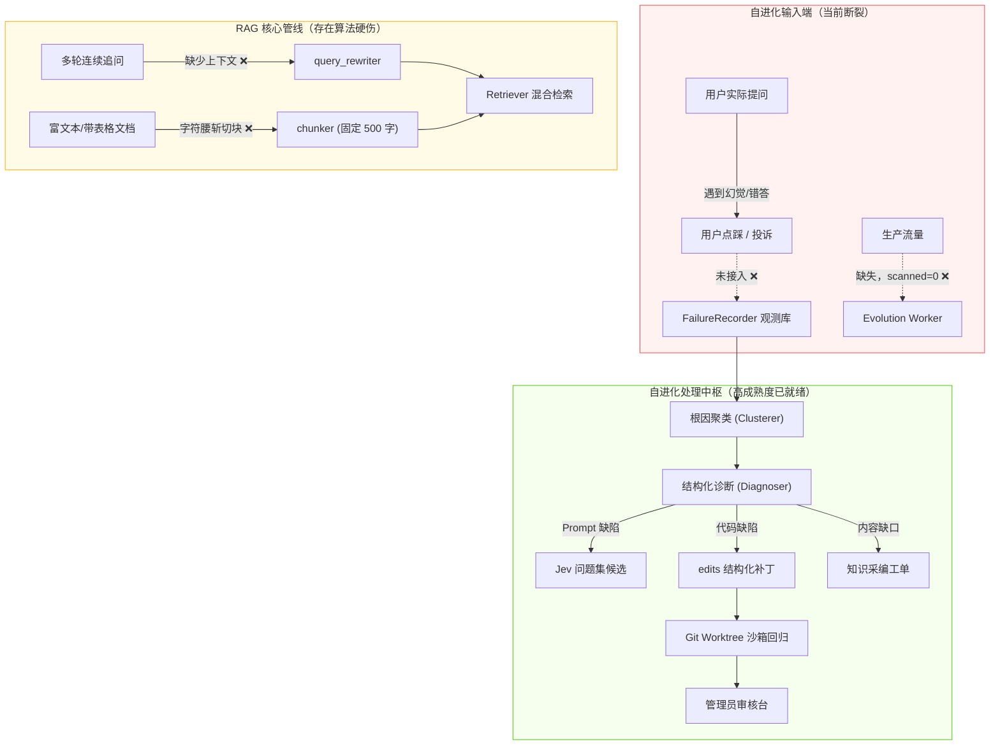
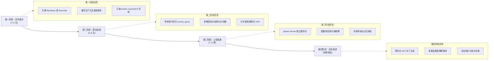

# RAGv3 全系统深度审计与生产就绪升级蓝图

> **生成时间**：2026-10-11  
> **适用项目**：[RAGv3](file:///d:/Desktop/RAGv3)（面向团队与企业的全功能 RAG 与自进化系统）  
> **基准代码状态**：`1999 passed / 1 skipped`，HEAD 包含结构化编辑（`edits`）、知识缺口工单（`KnowledgeGapTicket`）、AST 符号索引（`SymbolIndex`）与沙箱回放固件。

---

## 0. 执行摘要：系统定位与当前成熟度

RAGv3 在工程规范、代码测试网、边界防护和机制设计上展现出了极高的工业水准。通过 Git Worktree 强隔离、不可变测试网、管理员终审、灰度分流以及近期落地的结构化代码替换（`edits` 格式过界率达 100%），**系统已经完成了一套精密、安全的“受控沙箱实验台”**。

然而，从**“精密的受控实验台”**跨越到**“能打硬仗的生产级系统”**，系统当前暴露出的核心矛盾在于：
$$\textbf{防御与门禁机制高度成熟} \quad \text{vs} \quad \textbf{核心问答链路与真实生产流量断层}$$



---

## 一、 自进化系统的三道“断点”与闭环修复

### 1. 【P0 级缺陷】用户真实负向反馈（点踩 / 投诉）未进进化池

#### 现状审计
在 [`rag/api.py`](file:///d:/Desktop/RAGv3/rag/api.py#L1083-L1096) 中，用户反馈端点 `POST /feedback` 仅仅将评分记录写入了 `user_db`：
```python
# rag/api.py:1095
await asyncio.to_thread(user_db.add_feedback, req.message_id, user["id"], value_int, req.comment or "")
return {"status": "ok"}
```
在此逻辑中，**完全没有通知 `FailureRecorder`**。

> [!WARNING]
> 系统的自进化目前仅依赖“代码异常抛错（`route=error`）”和“模型自评低置信度（`insufficient_evidence`）”。
> 但现实中最严重的失败是**“模型一本正经地胡说八道（幻觉）”**——这种情况下内部指标全部判定为正常，只有用户会察觉并点踩。因为反馈未进演进池，**所有真实用户的 Bad Case 对系统全部隐形**。

#### 升级方案
在 `submit_feedback` 处理负向反馈（`value == "negative"`）时，根据 `req.message_id` 反查该次请求在 `execution_logs` 中的 ExecutionTrace，构造带用户投诉理由的 `DiagnosticDetail` 并推入 `FailureRecorder`：

```python
# 升级方案伪代码 (rag/api.py)
if req.value == "negative":
    trace = await asyncio.to_thread(_get_trace_by_message_id, req.message_id)
    if trace:
        recorder = get_failure_recorder()
        recorder.submit_failure_observation(
            trace=trace,
            detail=DiagnosticDetail(
                failure_stage="generation",
                root_cause_feature="prompt_or_workflow_defect",
                feedback_kind="user_thumbs_down",
                user_comment=req.comment,
            )
        )
```

---

### 2. 【P0 级瓶颈】“真实失败供给”为 0，演进 Worker 怠速空转

#### 现状审计
日志显示：`worker 每 900s 一轮，scanned=0 —— 空转中（无真实流量）`。系统目前所有自进化制品的产生，均依赖离线脚本合成注入。

#### 升级方案
构建**“暗度陈仓”生产回放与流量影子机制（Shadow Ingestion Pipeline）**：
1. **历史线上日志重放工具**：编写 `scripts/ingest_historical_traffic.py`，读取现存的业务问答日志或企业支持工单，按原样打入问答管线并记录 Trace。
2. **探针问答生成器（Active Probing）**：复用既有的知识缺口工单算法，定期对各个知识库生成探针问题，主动探测知识边缘，变被动等待报错为主动巡检。

---

### 3. 【P2 级局限】单文件补丁天花板与跨文件协同（Multi-File Patching）

#### 现状审计
虽然 `edits` 结构化替换格式消除了 hunk 算术错误，但由于定位机制绑定了单帧或单符号（`SymbolIndex`），补丁生成器每次只能定位修改 1 个文件。

#### 升级方案
引入**接口调用图（Call-Graph Context Expansion）**：
- 当定位到目标修改函数（如 `Retriever._rrf_fuse`）后，通过 AST 追踪其在 `rag/pipeline.py` 中的调用点；
- 生成器提示词中同时提供 `(caller_excerpt, callee_excerpt)`，支持输出包含多个 `target_file` 的结构化编辑列表（`List[FileEdit]`），实现跨文件的协同补丁。

---

## 二、 RAG 核心算法与问答链路的深度重构

### 1. 【P1 级缺陷】多轮对话上下文改写缺失（Contextual Query Rewriting）

#### 现状审计
查看 [`rag/query_rewriter.py`](file:///d:/Desktop/RAGv3/rag/query_rewriter.py#L10-L23)：
```python
def rewrite_query(question: str) -> str:
    prompt = _pm.render("rewrite", question=question)
    # ...
```
该函数只接收孤立的 `question` 字符串，**完全不接收上下文历史（`history`）**。

> [!CAUTION]
> 面对用户多轮追问（例如“它支持防抖吗？”、“第二种方案多少钱？”），检索器拿到的是没有主语的孤立句子，导致第二轮检索质量断崖式崩塌，直接引发检索失靶或误拒答。

#### 升级方案
重构改写器签名，注入会话窗口：
```python
def rewrite_query(question: str, history: list[dict] = None) -> str:
    if not history:
        # 单轮快速路径
        return _rewrite_single(question)
    
    # 多轮指代消解路径
    recent_context = _format_recent_turns(history, max_turns=2)
    prompt = _pm.render("rewrite_multiturn", question=question, context=recent_context)
    # 生成独立完整的完整检索词（De-contextualized Query）
```

---

### 2. 【P1 级缺陷】文档通用切块结构损坏（表格与行截断）

#### 现状审计
查看 [`rag/chunker.py`](file:///d:/Desktop/RAGv3/rag/chunker.py#L21-L30)：
```python
splitter = RecursiveCharacterTextSplitter(
    chunk_size=chunk_size,
    chunk_overlap=overlap,
    length_function=len,
    separators=["\n\n", "\n", "。", ".", " ", ""],
)
```
整个通用文档分块仅仅依赖字符长度暴力截断。

> [!NOTE]
> 在实测案例 obs#8 中，**一行 22 列的配置表被暴力截成前 12 列**，后半截被推到下一个块，导致模型在检索时无法看到完整型号对应关系。

#### 升级方案
升级为**Markdown 与结构感知分块器（Markdown & Table Aware Chunker）**：
1. **表格保护守卫**：检测到 Markdown 表格标记（`| --- |`）时，强制将整表或至少“表头 + 连续数据行”作为不可分割的原子单元（Atomic Chunk）。
2. **标题层级元数据挂载**：切块时解析 `#`、`##` 标题，将父级标题路径（如 `产品参数 > 光学特性 > 镜头兼容性`）作为 `breadcrumb` 隐式前缀注入块内容开头，极大增强稀疏 BM25 和稠密向量的主题命中率。

---

### 3. 【P2 级演进】多模态图表理解（VLM 视觉注入）

#### 现状审计
目前 PDF 主要依赖 `opendataloader-pdf` 转换为纯文本 Markdown，图片依赖 RapidOCR。技术手册中的电气原理图、架构图、折线图在转换为文本后完全丧失语义。

#### 升级方案
在增量资料管理管线（[`rag/materials/extraction.py`](file:///d:/Desktop/RAGv3/rag/materials/extraction.py)）中引入可选的 **VLM 图表理解卡片**：
- 提取 PDF/Docx 中的嵌入图片与矢量图；
- 异步调用轻量多模态模型（如 Gemini Flash / Qwen-VL）生成图片的结构化文本摘要（Caption + 数据键值对提取）；
- 将生成的图表说明作为虚拟文档块存入向量库与 BM25，实现“以文搜图、以图答文”。

---

## 三、 底层工程架构与扩展性加固

### 1. 消除 6 个本地 SQLite 数据库的文件锁瓶颈

#### 现状审计
项目在 `data/` 目录下同时运行 6 个独立的 SQLite 数据库：
- `users.db`（用户与权限）
- `memory.db`（会话记忆与追踪）
- `analysis.db`（分析卡片）
- `bm25_index.db`（BM25 倒排快照）
- `evolution.db`（自进化观测与制品）
- `embedding_cache.sqlite3`（嵌入缓存）

#### 隐患与升级
1. **多容器部署障碍**：本地文件 SQLite 使得多实例横向扩展（如 Docker Swarm / Kubernetes Pod 水平伸缩）无法共享状态。
2. **Qdrant 本地锁解耦**：当前配置为 `qdrant_path`（本地嵌入式模式），单进程启动独占文件锁，导致评测脚本和沙箱每次都要强制全量拷贝 Qdrant 目录到 `%TEMP%`。
3. **架构升级目标**：
   - 生产部署将向量库切换为独立的 **Qdrant Server（HTTP/gRPC）**，彻底消除文件锁竞争；
   - 业务数据层（用户、权限、会话、进化元数据）抽象出统一的 SQLAlchemy / SQLModel Repository 接口，保留 SQLite 作为单机开发默认，同时支持切换至 PostgreSQL 生产集群。

---

### 2. 回归基准集规模扩容（Benchmark Scaling）

#### 现状审计
目前核心门禁基准 [`benchmarks/real-cases-v1.json`](file:///d:/Desktop/RAGv3/benchmarks/real-cases-v1.json) 仅包含 20 个测试案例。

#### 风险与升级
在 20 个样本上，**错一个用例就是 5.0%（5pp）的指标跌幅**，极容易受模型的单次推理随机方差干扰。
- **扩充至 100~200 例**：覆盖常规问答（50 例）、跨文档表格对比（30 例）、多轮追问（30 例）、越权/拒答测试（30 例）、对抗/注入测试（20 例）；
- **引入统计置信度门禁**：在判定时引入置信区间，避免因单个边缘 case 的随机浮动阻断有效迭代。

---

## 四、 四阶段实施路线图（Implementation Roadmap）



### 交付物核对表 (Milestone Checklist)

| 阶段 | 核心交付物 | 验证手段 | 收益 |
| :--- | :--- | :--- | :--- |
| **Phase 1** | 1. `rag/api.py` 负向反馈挂钩<br>2. `scripts/replay_traffic.py` | 模拟用户点踩，验证 `evolution.db` 中产生对应的观测记录 | **自进化系统真正具备了“感知用户抱怨”的器官** |
| **Phase 2** | 1. 上下文改写器 `rewrite_query`<br>2. 表格保护分块器 `chunker.py` | 多轮代词追问准确率测试；obs#8 表格截断复现测试 | **多轮问答体验与表格检索命中率质的提升** |
| **Phase 3** | 1. 独立 Qdrant 容器配置<br>2. 100 例基准集扩容 | 沙箱回放直接走 Qdrant 只读只写隔离，消除本地目录拷贝 | **彻底消除本地锁竞争，支撑高并发与多实例** |
| **Phase 4** | 1. 跨文件编辑能力<br>2. 知识补全工单全自动流转 | 构造涉及 pipeline 与 retriever 联动的多文件回归用例 | **迈向真正的全自主软件与知识双轮自愈** |

---

> [!TIP]
> **结论**：本项目的架构地基（沙箱、状态机、权限隔离、回归网）打得极其扎实，在开源界位列前茅。只要按照上述路线图补齐**“多轮问答上下文改写”**、**“表格切块完整性”**与**“用户负向反馈入库”**三块关键拼图，整个系统就真正具备了在复杂真实企业场景中长期生存、自我生长的硬核能力。
