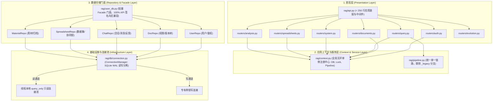

# RAGv3 架构深度治理与防腐重构主计划 (Superpowers Remediation Master Plan)

**日期：** 2026-10-17  
**状态：** 方案评审中 (Pending Review - 严禁在用户确认前执行代码修改)  
**设计目标：** 彻底拔除全系统六大“屎山化”病灶，消除裂脑幽灵代码，理顺依赖拓扑，释放并发性能，完成巨石组件解耦。

---

## 一、 现状穿透式检索与病灶定性

经过对全代码库的静态内省、调用图谱遍历和正则检索，确认同事的评估 **100% 属实，核心数据如下**：

| 诊断维度 | 真实测量数据 | 核心隐患定位 |
| :--- | :--- | :--- |
| **上帝类膨胀** | `rag/user_db.py` **3,723 行** (175 个方法, 37 张表) `rag/api.py` **2,571 行** (65 个直接端点) `rag/pipeline.py` **1,124 行** (4 个平行组装分支) | 严重违反单一职责原则，新增任何特性都向巨石文件无序塞代码。 |
| **重构断层与裂脑** | `rag/routers/` 下的 `auth.py`, `documents.py`, `query.py`, `system.py` **未被 `api.py` 挂载**！ `rag/db/connection.py` **未被 `UserDB` 接入**！ | 形成“双轨裂脑”：磁盘上存在新模块，生产运行与测试打跑的却是 `api.py` 和原生 `user_db.py` 老实现。 |
| **循环依赖遮羞布** | 后端函数内 `import` / `from` 语句高达 **366 处**！ `api.py`: 71, `worker.py`: 25, `pipeline.py`: 18, `user_db.py`: 14 | 模块分层严重混乱，底层领域模型反向 `import rag.api` 提取全局单例，只能用函数内局部 import 掩盖循环导入崩溃。 |
| **并发锁与走钢丝** | 单一不可重入锁 `self._lock = threading.Lock()` 单一 SQLite 原生连接 `self._conn` | 读写全串行排队。公有方法加锁，内部 `_in_tx` 不加锁，一旦跨方法事务嵌套立即全进程死锁。 |
| **过度工程侵入** | `rag/evolution/` 子系统达 **12,715 行** (占后端近 1/3) | 自愈演化系统代码量过大，直接硬编码侵入 `pipeline.py` 核心检索路径，导致主管道臃肿。 |
| **前端巨石单文件** | `EvolutionCenterView.vue` **2,054 行** `WikiModeView.vue` **1,354 行** `KnowledgeDetailView.vue` **1,033 行** | 单组件集成 6 个 Tab、全量模态框、状态机和 AST 差异查看器，无子组件抽象。 |

---

## 二、 核心架构重构设计蓝图

---

## 三、 四阶段分步实施计划 (Four-Phase Execution Plan)

### Phase 1: 消除裂脑与幽灵代码（止血阶段 - 彻底终结双轨运行）
- [ ] **Task 1.1: 真实挂载 `rag/routers/` 并对齐接口**
  - 在 [`rag/api.py`](file:///d:/Desktop/RAGv3/rag/api.py) 中正式挂载：
    - `auth_router` (`/auth/*`, `/login`, `/me`)
    - `documents_router` (`/files/*`, `/upload`, `/documents/*`, `/batch-import`)
    - `query_router` (`/query`, `/query/stream`, `/conversations/*`)
    - `system_router` (`/health`, `/analytics/gaps`)
  - 从 `rag/api.py` 中精准剔除已搬迁的重复路由函数定义。
  - 运行 `pytest tests/test_router_parity.py`，断言 158 个端点路径与请求方法 100% 严格一致。
- [ ] **Task 1.2: 验证端到端测试链路**
  - 执行 `pytest tests/test_api.py tests/test_auth_session_security.py tests/test_batch_import.py tests/test_analysis.py`。
  - 确保真实挂载后零 404、零鉴权异常。

---

### Phase 2: 上下文单例解耦与拔除 366 处 Lazy Import（理筋阶段）
- [ ] **Task 2.1: 创建无环应用上下文 `rag/context.py`**
  - 提取目前定义在 `rag/api.py` 中的全局单例：`user_db`, `pipeline`, `_pipeline_lock`, `get_gap_analyzer`。
  - 彻底切断任何下层领域文件对 `import rag.api` 的反向依赖！
- [ ] **Task 2.2: 模块依赖拓扑归正（自底向上）**
  - 制定严格的依赖规则：`Models -> Repositories -> Context -> Pipeline -> Routers -> api.py`。
  - 逐文件将 366 处函数内 `from ... import` 上移至文件头部。
  - 配置并运行 `ruff check .`，彻底杜绝隐式循环依赖。

---

### Phase 3: `UserDB` 上帝类仓储化与真正接入连接池（拆骨阶段）
- [ ] **Task 3.1: 将 `ConnectionManager` 注入 `UserDB`**
  - 修改 [`rag/user_db.py`](file:///d:/Desktop/RAGv3/rag/user_db.py)，将其内部底层的 `self._conn` 和 `self._lock` 替换为 [`rag/db/connection.py`](file:///d:/Desktop/RAGv3/rag/db/connection.py) 的 `ConnectionManager`。
  - 所有查询方法采用只读连接池，写方法走事务锁。
  - 运行 `pytest tests/test_db_connection.py tests/test_user_db_facade.py` 验证并发读写安全性。
- [ ] **Task 3.2: 仓储子类拆分与 Facade 门面委托**
  - 提取 `rag/repositories/`：
    - `user_repo.py`
    - `document_repo.py`
    - `chat_repo.py`
    - `spreadsheet_repo.py`
    - `material_repo.py`
  - `UserDB` 瘦身为纯 Facade 类，将 175 个方法逐一委托给子 Repo，外部接口签名保持 100% 不变。
  - 运行全量 2,200+ 后端测试，确保无破坏性改动。

---

### Phase 4: `Pipeline.py` 主干精简与前端巨石组件子组件化（治本阶段）
- [ ] **Task 4.1: `Pipeline.py` 流程归一化**
  - 清理 `_prepare_context_legacy` 废弃死逻辑，将 `_prepare_context` 收敛为单一主线。
  - 将 `FailureRecorder` 的自愈演化上报改为事件监听模式，解耦主检索流程。
- [ ] **Task 4.2: 前端 `EvolutionCenterView.vue` 模块化**
  - 将 2,054 行的单文件组件拆解为 6 个独立的 Tab 子组件：
    - `frontend/src/views/evolution/ObservationsTab.vue`
    - `frontend/src/views/evolution/ClustersTab.vue`
    - `frontend/src/views/evolution/CandidatesTab.vue`
    - `frontend/src/views/evolution/CodePatchesTab.vue`
    - `frontend/src/views/evolution/GapTicketsTab.vue`
    - `frontend/src/views/evolution/MetricsTab.vue`
  - 运行 `npm run build && npx vitest run` 确保构建无误、测试全绿。

---

## 四、 零风险门禁保障机制 (Verification Gates)

1. **接口兼容门禁：** 任何重构不得改变现有 HTTP URL、入参、响应体格式与状态码（通过 `test_router_parity.py` 强校验）。
2. **测试全量门禁：** 每一步完成后必须运行 `pytest` 与 `vitest`，全量测试必须 100% Green。
3. **代码规范门禁：** `ruff check .` 保持 0 error / 0 warning。
