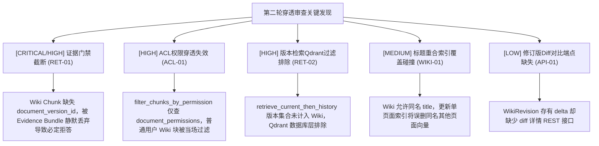

# 全项目代码第二轮穿透式深度审查报告（Superpowers Deep Code Review Round 2）

日期：2026-10-14  
审查级别：穿透式跨子系统集成审查（Superpowers Strict End-to-End Audit）  
审查重点：双模态检索链路集成、企业级证据门禁（Evidence Bundle）、ACL 权限穿透、Qdrant 向量版本隔离

---

## 一、审查背景与执行概要

在第一轮针对超文本 Wiki 子系统单体实现与权限守卫的审查闭环后，本轮审查重点深入到**跨子系统的端到端集成链路**（End-to-End Cross-Subsystem Integration）：
- 模拟真实生产环境下，普通组织员工通过检索链路（`RAGPipeline`）发起问答时，双模态底座（文件表格 + 超文本 Wiki）如何被检索、版本控制、ACL 过滤与组装成证据束（Evidence Bundle）；
- 审查各子系统在多版本生命周期、Qdrant 稠密过滤条件以及 SQLite 并发模式下的行为边界。

### 基线质量指标
- 静态检查：`ruff check .` 保持 **0 告警**。
- 单体测试：全量 2132 项历史测试用例与 Wiki 专项 30 项用例全部通过。

---

## 二、第二轮深度审查发现清单（Severity Matrix）



---

### 1. [CRITICAL / HIGH] 发现 RET-01：Wiki 分块缺失 `document_version_id`，被企业证据门禁（Evidence Bundle）静默丢弃导致必定拒答
- **涉及文件**：
  - [`rag/wiki/chunker.py#L33-L57`](file:///d:/Desktop/RAGv3/rag/wiki/chunker.py#L33-L57)
  - [`rag/wiki/indexer.py#L42-L72`](file:///d:/Desktop/RAGv3/rag/wiki/indexer.py#L42-L72)
  - [`rag/pipeline.py#L818-L828`](file:///d:/Desktop/RAGv3/rag/pipeline.py#L818-L828)
  - [`rag/reliability/bundle.py#L28-L29`](file:///d:/Desktop/RAGv3/rag/reliability/bundle.py#L28-L29)
- **代码定位**：
  `RAGPipeline._finalize_rag_context`：
  ```python
  citable = [
      chunk for chunk in context
      if chunk.document_id is not None and chunk.document_version_id is not None
  ]
  ```
- **问题机理**：
  在开启企业可信证据门禁模式下（`settings.answer_reliability_enabled = True`），`_finalize_rag_context` 强制要求候选证据块必须具备版本溯源信息。而 `WikiChunk.to_chunk` 生成的标准分块中，`document_version_id` 始终为 `None`。因此，即使 Wiki 页面包含标准答案且被高分召回，在进入门禁证据束时也会被日志记录：
  `dropped X chunk(s) without version metadata before the evidence bundle`
  并被直接全数剔除出 `context`。随后的 `decide_answerability` 判定可用证据数为 0，强制判定为 `insufficient_evidence`（证据不足）而拒答。
- **潜在危害**：
  生产环境下，企业可信问答链路对所有超文本 Wiki 知识完全失效（100% 触发证据不足拒答）。
- **修复方案**：
  - 在 `WikiChunk.to_chunk` 中补充入参 `document_version_id: int | None = None, version_no: int | None = None`；
  - 在 `WikiIndexer.sync_page` 中，将当前页面的 `current_revision_id` 作为 `document_version_id` 与 `version_no` 注入分块，并同步传给 `add_to_collection`。

---

### 2. [HIGH] 发现 ACL-01：非管理员用户检索 Wiki 时，分块被 `filter_chunks_by_permission` 误判为“无权限记录”并全数丢弃
- **涉及文件**：[`rag/permissions.py#L144-L193`](file:///d:/Desktop/RAGv3/rag/permissions.py#L144-L193)
- **代码定位**：`filter_chunks_by_permission`
  ```python
  doc_names = list(set(c.doc_name for c in chunks))
  perm_map = db.get_document_permissions_by_names(doc_names, kb_id)
  ...
  for c in chunks:
      perm = perm_map.get(c.doc_name)
      if perm is not None and c.doc_name in allowed_set:
          result.append(c)
      # else: 无权限记录或用户无权，过滤掉
  ```
- **问题机理**：
  `filter_chunks_by_permission` 设计用于上传的文件文档（表 `document_permissions`），而 Wiki 页面存储在 `wiki.db` 的 `wiki_pages` 表中，不产生 `document_permissions` 记录。
  当管理员提问时，`if user.get("is_admin"): return list(chunks)` 放行；但当任何普通组织用户提问时，系统在 `document_permissions` 表中找不到 Wiki 页面的 `doc_name`，`perm` 恒为 `None`，导致所有 Wiki 块全部被作为“无权限记录的非法文件”过滤淘汰。
- **潜在危害**：
  普通员工完全无法在 RAG 对话中召回任何 Wiki 知识。
- **修复方案**：
  在 `filter_chunks_by_permission` 中增加对 `chunk.chunk_kind == "wiki"` 的分支判断：
  Wiki 页面继承知识库级别的访问控制——只要当前用户对 `kb_id` 具备可读权限（组织策略下 `OrgAuthorizationService.authorize(..., OrgRole.READ).allowed`，或普通知识库 `can_user_view_kb`），则保留其 Wiki 分块。

---

### 3. [HIGH] 发现 RET-02：版本化检索 `retrieve_current_then_history` 的 Qdrant 过滤条件排除了 Wiki 页面修订版
- **涉及文件**：[`rag/versioned_retrieval.py#L37-L56`](file:///d:/Desktop/RAGv3/rag/versioned_retrieval.py#L37-L56)、[`rag/vector_store.py#L381-L386`](file:///d:/Desktop/RAGv3/rag/vector_store.py#L381-L386)
- **代码定位**：`_visible_current_version_ids` 与 `search_collection(allowed_version_ids=...)`
- **问题机理**：
  在主检索链路 `retrieve_current_then_history` 中，为防止召回历史过时版本，先通过 `_visible_current_version_ids` 计算出当前允许的有效版本 ID 集合 `allowed_version_ids` 并下推给 Qdrant。但该函数仅从 `user_db` 的 `document_permissions.current_version_id` 取值，未计入 `wiki_pages.current_revision_id`。
  下推至 Qdrant 时，`FieldCondition(key="document_version_id", match=MatchAny(any=allowed_version_ids))` 会在数据库层直接将 Wiki 分块排除在外。
- **修复方案**：
  当用户具备知识库查看权限时，`_visible_current_version_ids` 自动并入该知识库下所有当前有效 Wiki 页面的 `current_revision_id`；或者在 `search_collection` 过滤逻辑中，明确放行属于当前有效 Wiki 页面的向量。

---

### 4. [MEDIUM] 发现 WIKI-01：同知识库允许重名 Wiki 页面（Title Collision），导致 Qdrant 向量误删踩踏
- **涉及文件**：[`rag/wiki/store.py#L42-L56`](file:///d:/Desktop/RAGv3/rag/wiki/store.py#L42-L56)、[`rag/wiki/store.py#L206-L250`](file:///d:/Desktop/RAGv3/rag/wiki/store.py#L206-L250)
- **问题机理**：
  数据库中仅定义了 `UNIQUE(kb_id, slug)`，未约束 `(kb_id, title)` 唯一性；`WikiStore.update_page` 亦未校验是否与其他页面的 `title` 重复。在 Qdrant 中分块的 `doc_name` 为页面标题；当两篇不同 slug 的页面使用了相同的 title 时，任何一篇页面同步或删除都会按 `doc_name` 批量删除或覆盖向量点，导致另一篇页面的向量索引被意外抹除。
- **修复方案**：
  在 `WikiStore.create_page` 与 `WikiStore.update_page` 中强制校验 `(kb_id, title)` 唯一性（同知识库内标题不得重名）。

---

### 5. [LOW] 发现 API-01：Wiki 修订版存有统一 Diff 却未暴露版本对比 REST 端点
- **涉及文件**：[`rag/wiki/api.py#L166-L175`](file:///d:/Desktop/RAGv3/rag/wiki/api.py#L166-L175)
- **问题机理**：
  `WikiRevision` 在每次更新时计算并保存了与前一版本的统一 diff（`delta`），但在 API 层仅提供了 `/pages/{id}/history` 列表接口，未提供直接读取 delta 或对比两个版本的接口，前端需要拉取两份完整文本自行计算。
- **修复方案**：
  增加 `GET /wiki/pages/{page_id}/revisions/{revision_num}/diff` 端点，直接返回该版本生成的 delta 变更详情。

---

## 三、整改行动计划（Remediation Plan）

| 编号 | 任务分类 | 目标与验收 |
| :--- | :--- | :--- |
| **Task 1** | **[CRITICAL] 门禁版本对齐** | `WikiChunk` 与 `WikiIndexer` 补齐 `document_version_id` 与 `version_no`，添加 Red-Green 测试确保 `_finalize_rag_context` 0 丢弃 |
| **Task 2** | **[HIGH] 检索 ACL 穿透** | 在 `filter_chunks_by_permission` 中放行拥有 KB 查看权的 Wiki 分块 |
| **Task 3** | **[HIGH] Qdrant 版本集合并** | 在 `_visible_current_version_ids` 中动态并入当前知识库的 Wiki `current_revision_id` |
| **Task 4** | **[MEDIUM] 标题唯一性防护** | 在 `WikiStore.create_page` 与 `update_page` 增加同库重名拦截 |
| **Task 5** | **[LOW] 修订版 Diff 端点** | 挂载 `GET /wiki/pages/{id}/revisions/{num}/diff` 接口并补齐测试 |
| **Task 6** | **端到端穿透回归** | 模拟普通用户发起端到端 RAG 提问，断言 Wiki 知识正常召回并通过 Evidence Bundle 门禁作答 |
