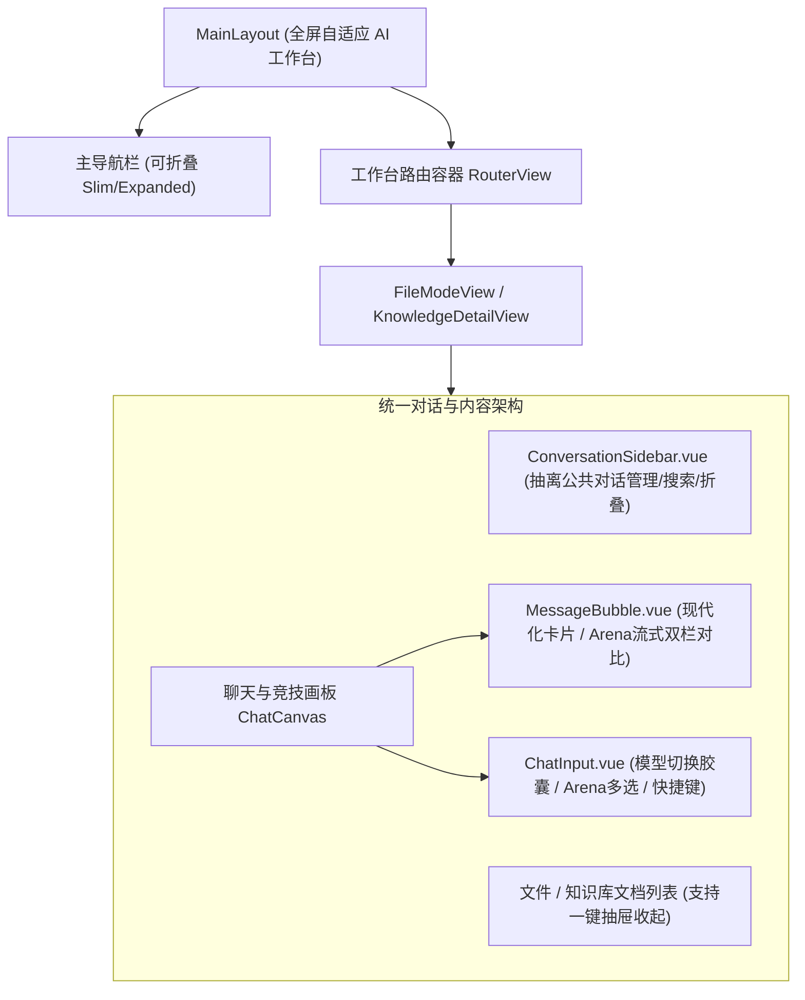

# 前端视觉美化与交互重构技术方案 (Design Specification)

## 1. 目标与背景

用户提出对 RAGv3 的前端进行全面美化与功能重构，核心诉求为：
1. **视觉美化**：现代化 AI 工作台风格（参考 Linear / Claude / Perplexity 现代设计），摆脱传统后台系统的沉闷感；
2. **操作简化**：消除多栏并排挤压，优化信息层次，支持侧栏灵活折叠/展开、沉浸专注模式（Focus Mode）、一键快捷操作；
3. **功能重构**：抽象复用公共组件（统一对话侧栏、现代模型选择器、Arena 竞技对比卡片），提升流畅度与响应式体验。

---

## 2. 现状痛点与重构对照

| 维度 | 现状痛点 | 重构目标 |
| :--- | :--- | :--- |
| **空间挤压** | 主侧栏(240px) + 对话历史(240px) + 文件/文档栏(280px) + 聊天区，4栏并排使问答区域狭窄不堪 | **自适应 3 栏/2 栏弹性工作台**：主导航精简，对话历史与资源面板支持一键折叠（快捷键 `Ctrl+B` 或图标收起），阅读区最大化 |
| **视觉质感** | 普通白灰背景、硬边框、系统 Emoji 原生图标（📄、📚、🌐、🛠️），缺乏质感 | **Modern AI Studio 质感**：精选 Indigo/Violet 现代品牌色、轻量磨砂玻璃、平滑圆角、微光呼吸流式动画、精美 SVG 图标 |
| **组件重复** | `FileModeView` 与 `KnowledgeDetailView` 存在大量完全相同的对话侧边栏与历史管理代码 | **组件化抽象**：抽离 `ConversationSidebar.vue`，实现全局状态联动、搜索筛选与操作聚合 |
| **模型交互** | 顶部简单的 Select 下拉框，Arena 多模型对比开关不直观 | **胶囊式模型控制台**：直观展示大模型能力标签、实时延迟状态、一键 Arena 竞技对齐对比 |
| **内容气泡** | 消息气泡为纯色卡片，多模型 Arena 并排布局简陋，复制等交互不便捷 | **精美对话卡片**：流式渐变呼吸指示、Markdown 语法渲染优化、代码块一键复制、Arena 独立对比高亮 |

---

## 3. 设计规范 (Design Tokens System)

升级 `frontend/src/styles/design-tokens.css`：

```css
:root {
  /* 品牌与基色：优雅深邃的 AI Indigo 色系 */
  --color-primary: #4f46e5;
  --color-primary-hover: #4338ca;
  --color-primary-light: #eef2ff;
  --color-accent: #6366f1;
  --color-accent-subtle: #f5f3ff;

  /* 背景与层次表面色（Surface Layers） */
  --color-bg-app: #f8fafc;
  --color-surface-card: #ffffff;
  --color-surface-panel: #fcfdfe;
  --color-surface-hover: #f1f5f9;

  /* 边框与微阴影（Refined Shadows） */
  --color-border-subtle: #e2e8f0;
  --color-border-strong: #cbd5e1;
  --shadow-card: 0 1px 3px rgba(15, 23, 42, 0.04), 0 4px 12px -2px rgba(15, 23, 42, 0.03);
  --shadow-hover: 0 4px 6px -1px rgba(15, 23, 42, 0.07), 0 10px 20px -3px rgba(15, 23, 42, 0.05);
  --shadow-glow: 0 0 16px rgba(99, 102, 241, 0.18);

  /* 圆角规范 */
  --radius-sm: 6px;
  --radius-md: 10px;
  --radius-lg: 16px;
  --radius-full: 9999px;
}
```

---

## 4. 架构与组件重构设计



### 4.1 核心组件升级清单
1. **`MainLayout.vue`**:
   - 替换系统 Emoji 为统一的精美 SVG 图标；
   - 增加侧栏收缩折叠按钮（Compact Rail 模式）；
   - 顶栏增加面包屑导航与工作区状态指示。
2. **`ConversationSidebar.vue`（新抽象组件）**:
   - 统一接管 FileMode 和 KnowledgeDetailView 中的会话历史；
   - 具备即时会话搜索、新建、重命名、删除功能；
   - 支持收起折叠按钮，一键腾出 240px 视口宽度。
3. **`ChatInput.vue`（输入工作台重塑）**:
   - 现代悬浮胶囊设计，支持多模型 Arena 快捷分栏选择；
   - 针对不同模型展示直观的标识（DeepSeek、Qwen 等）；
   - 快捷提示词（Prompt Prompts）横向滚动卡片推荐。
4. **`MessageBubble.vue`（气泡与竞技呈现重塑）**:
   - 极简卡片质感，代码块支持一键复制与高亮；
   - Arena 模式支持对比卡片标题栏高亮、状态徽标、耗时徽章与一键折叠。
5. **知识库与文件列表卡片（`KBModeView.vue`, `FileModeView.vue`）**:
   - 卡片增加微悬浮动效（Hover Lift）、分类徽章与现代操作菜单。

---

## 5. 测试与无回归保证
- 保证所有原有 `data-test` 属性（如 `data-test="arena-grid"`, `data-test="create-kb"` 等）完全保留，确保现存 230 个 Vitest 前端单元测试 100% 保持通过。
- 保证前后端数据流（SSE 流式事件、单模型及 Arena 多模型）完全不受影响。
- 保证 `npm run build` 和 TypeScript 编译 0 警告、0 报错。
